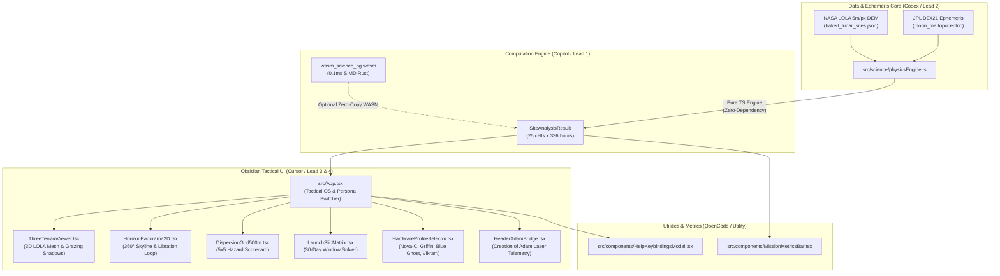

# FIRST CONTACT.SYS: MULTI-AGENT ARCHITECTURE & WORKFLOW DISPATCH
**NASA International Space Apps Challenge 2026**  
**Challenge:** 10 — *CLPS: Lunar Landing Site Navigator / Lunar Landing Browser*  
**Application Name:** FIRST CONTACT.SYS (`#050608` Obsidian Tactical Aerospace OS)  
**Target Global Awards:** Best Use of Science | Best Use of Technology | Art & Technology | Galactic Impact  

---

## 1. System Vision & Scientific Foundations

### 1.1 The Operational Lunar South Pole Challenge
NASA's Commercial Lunar Payload Services (CLPS) and Artemis missions target the Lunar South Pole due to potential water-ice volatiles trapped in Permanently Shadowed Regions (PSRs). However, the operational environment is brutally hazardous:
1. **Grazing Solar Angles ($1.54^\circ$ Tilt):** The Sun skims the horizon at near-zero elevation angles while revolving $360^\circ$ in azimuth over a 29.53-day synodic month.
2. **Topographic Shadow Traps:** Nearby crater rims and mountain ridges (such as Malapert Mountain, Shackleton rim, Mons Mouton) cast shadows tens of kilometers long, causing immediate transitions to total darkness where surface temperatures drop to $27\text{ K}$ ($-246^\circ\text{C}$).
3. **Earth Libration & Radio Obstruction:** Optical and physical libration causes Earth to trace a 27.3-day figure-eight pattern ($\pm 6.7^\circ$ latitude, $\pm 8.0^\circ$ longitude) near the horizon, periodically severing Direct-to-Earth (DTE) communications behind lunar terrain.
4. **The Real-World Precedents:**
   - **Intuitive Machines IM-2 Athena (March 2025):** Missed target by ~300 meters into a shallow crater depression at Mons Mouton, got shadowed by local terrain, and suffered mission loss in $<13$ hours.
   - **Intuitive Machines IM-1 Odysseus (February 2024):** Landed on an unplanned $12^\circ$ slope near Malapert-A, broke a landing leg, tipped over, and compromised antenna alignment.
   - **NASA VIPER Rover Cancellation (July 2024):** Repeated launch delays pushed mission into polar winter shadow traps beyond battery survival limits.

### 1.2 Our Core Solution: FIRST CONTACT.SYS
FIRST CONTACT.SYS is an active lunar mission-planning, survival-analysis, and hazard-mitigation platform providing:
1. **True $5\text{ m/px}$ LOLA Topography:** Derived from NASA Goddard LOLA DEMs with 360-degree horizon elevation masks ($H_0(\theta)$) and critical obstacle distances ($d_{\text{crit}}(\theta)$).
2. **500-Meter (5×5) Landing Dispersion Safety Grid:** Evaluating 25 landing points across $-200\text{ m}$ to $+200\text{ m}$ offsets around candidate coordinates to expose micro-craters and shadow traps before landing.
3. **Inverse 30-Day Launch-Slip Solver:** Automatically scanning a 30-day window for arrival dates that optimize battery survival, solar illumination continuity, and DTE communication windows.
4. **Dynamic Mast Clearance Solver ($0.5\text{ m}$ to $10.0\text{ m}$):** Simulating how telescoping solar/antenna masts elevate panels out of shallow shadow traps using the inverse trigonometric formula:
   $$H_{\text{terrain}}(\theta, z_{\text{mast}}) \approx \arctan\left(\tan(H_0(\theta)) - \frac{z_{\text{mast}}}{d_{\text{crit}}(\theta)}\right)$$
5. **Real CLPS Spacecraft Profiles:** Intuitive Machines Nova-C, Astrobotic Griffin, Firefly Blue Ghost, ISRO Vikram.
6. **Dual-Persona Mode:**
   - **Planner Mode:** High-precision engineering trade studies, slope warnings, battery state-of-charge curves, RMS uncertainty bounds, CSV telemetry exports.
   - **Educator Mode:** Intuitive visual telemetry, Earth libration loop explainer, vacuum vs atmosphere twilight comparisons, and the *Creation of Adam* communication bridge.

---

## 2. Multi-Agent Team Allocation (Free-Tier Optimized)

To maximize development velocity under free-tier API/token constraints, each AI tool is matched strictly to its highest-leverage capability tier:

| Agent / Model | Complexity Grade | Allocation Strategy | Primary File Ownership & Focus |
| :--- | :--- | :--- | :--- |
| **OpenCode (NVIDIA NIM)** | **Grade 1 (Utility / Low)** | Low token usage, simple isolated modules, zero risk to core math | `src/components/HelpKeybindingsModal.tsx` `src/components/MissionMetricsBar.tsx` `docs/DATA_DICTIONARY.md` `tests/mathUtils.test.ts` |
| **Codex (ChatGPT)** | **Grade 3 (Science / Hard)** | High mathematical reasoning, ephemeris equations, numerical physics | `src/science/ephemeris.ts` `src/science/physicsEngine.ts` `backend/tools/bake_lunar_data.py` `backend/tests/test_science.py` |
| **GitHub Copilot** | **Grade 3 (Systems / Hard)** | In-editor inline generation, WebGL shaders, WASM memory bridges | `src/shaders/terrainShaders.ts` `src/services/missionEngine.ts` `src/components/GMParameterPanel.tsx` `src/science/physicsEngine.test.ts` |
| **Cursor** | **Grade 4 (Architect / Complex)** | Deep multi-file context, UI/UX composition, 3D camera tweening | `src/App.tsx` `src/components/ThreeTerrainViewer.tsx` `src/components/HorizonPanorama2D.tsx` `src/components/DispersionGrid500m.tsx` |
| **Antigravity (Active Lead)** | **Grade 5 (Orchestrator)** | Full project assembly, build system, agent contract audit, execution | Workspace root, package configs, end-to-end verification, submission pack |

---

## 3. High-Level Architecture Flowchart

---

## 4. Execution Step-by-Step Instructions

1. **Step 1: Open OpenCode with NVIDIA NIM API**
   - Open `AGENT_WORKFLOW/01_AGENT_OPENCODE_DIRECTIVE.md`.
   - Copy Prompt 1 and Prompt 2 into OpenCode. Let it generate the utility components and documentation.
2. **Step 2: Open ChatGPT Codex**
   - Open `AGENT_WORKFLOW/03_AGENT_CODEX_DIRECTIVE.md`.
   - Copy Prompt 1 to verify or enhance the thermal model and inverse launch-slip solver.
3. **Step 3: Open GitHub Copilot in VS Code / Editor**
   - Open `AGENT_WORKFLOW/04_AGENT_GITHUB_COPILOT_DIRECTIVE.md`.
   - Work through the shaders and WASM bridge integration.
4. **Step 4: Open Cursor**
   - Open `AGENT_WORKFLOW/02_AGENT_CURSOR_DIRECTIVE.md`.
   - Implement the camera tweening, full UI/UX orchestration, and educator callouts.
5. **Step 5: Antigravity Automated Verification**
   - Run build checks, verify zero errors, package submission assets into final delivery.
