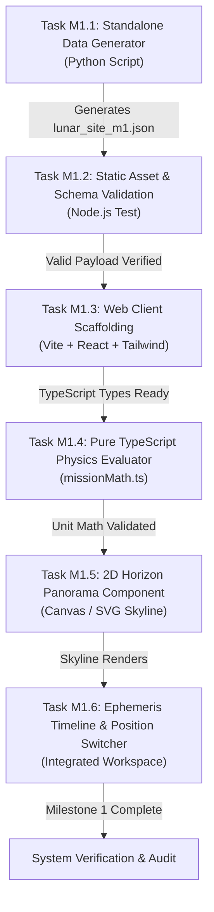

# PROPOSED PLAN: FIRST CONTACT.SYS (MILESTONE 1 FOCUS)

**Document Status:** Architectural Proposal & Alignment Strategy  
**Precedence:** This document supersedes all prior tasklists and execution roadmaps until Milestone 1 is verified.  
**Constraint Enforcement:** Planning only. No application code, dependency installs, dataset downloads, or edits to existing files have been executed.

---

## 1. CONFLICTS & DISCREPANCIES IN EXISTING SPECIFICATIONS

An exhaustive comparative audit across `AGENTS.md`, `BLUEPRINT.md`, `deep_research.md`, and `team_work.md` reveals critical divergences that must be resolved prior to implementation:

### 1.1 Team Architecture & Role Allocations
* **The Conflict:**
  * `BLUEPRINT.md` (Lines 3, 397–484) defines a **5-person distributed team** across India (IST) and the UK (GMT), breaking tasks across Leads 1 through 5.
  * `team_work.md` (Lines 3, 33–114) specifies a **4-person team**, merging Lead 5's responsibilities into Lead 4.
  * `deep_research.md` (Lines 312–324) references execution by a "solo engineer or team".
  * `AGENTS.md` (Lines 191–235) removes lead numbers entirely in favor of an unassigned sequential tasklist.
* **Resolution for Milestone 1:** Treat all development as a single, unified execution thread with clear modular boundaries, independent of human team headcount or numbering conventions.

### 1.2 Technology Stack & Execution Architecture
* **The Conflict:**
  * `BLUEPRINT.md` and `team_work.md` mandate a **Rust WebAssembly kernel** (`wasm-science/` via `wasm-bindgen` and `glam`) providing zero-copy `Float32Array` pointers into WASM linear memory. `BLUEPRINT.md` (Line 279) also mentions an optional Python FastAPI backend (`backend/main.py`).
  * `deep_research.md` explicitly advocates for a **100% client-side static deployment** on Cloudflare Pages to guarantee ₹0 hosting and eliminate all cloud/server dependencies.
  * **Local Environment Reality Check:** The host machine has `node` (v24.19.0), `npm` (11.17.0), `git` (2.55.0), and Python 3.14 (`py`) installed. **Rust (`rustc`, `cargo`, `wasm-pack`) is NOT installed.** Attempting to mandate Rust/WASM in the initial phase creates an immediate build blocker.
* **Resolution for Milestone 1:** Implement physics and data models purely in standard, deterministic TypeScript running client-side. Defer Rust/WASM and FastAPI backends until after the core scientific interface is proven.

### 1.3 Deployment Target & Hosting Conflicts
* **The Conflict:**
  * `BLUEPRINT.md` (Line 496) references deploying to "Edge Vercel".
  * `deep_research.md` (Lines 102–110, 237) strongly cautions against Vercel due to bandwidth limits (100 GB hard cap with potential overage bills) and designates **Cloudflare Pages** as the unmetered, zero-cost production host.
* **Resolution for Milestone 1:** Standardize on static artifact generation compatible with any static host (Cloudflare Pages, GitHub Pages, or local preview).

### 1.4 Data Schema Inconsistencies
* **The Conflict:**
  * `BLUEPRINT.md` Section 8.2 defines `SiteAnalysisPayload` with metadata wrapped in a `site_metadata` object, flat `horizon_profile` arrays (`elevation_h0_deg`), and a `time_series` containing telemetry properties (`battery_soc_pct`, `surface_temp_k`).
  * `team_work.md` Section 3 defines Contract 1 with `center_coords: { lat, lon, elevation_m }` and `horizon_mask_360: { h0_deg, d_crit_m }`.
  * `AGENTS.md` Section 5 defines `interface BakedSite` with top-level coordinates (`lat_deg`, `lon_deg`) and omits battery/thermal arrays from `time_series`.
  * **Critical Spatial Disconnect:** All three documents specify a `dispersion_grid_5x5` consisting solely of scalar summaries (`dx_m, dy_m, elevation_m, slope_deg, p_sun_pct, longest_darkness_hrs, status`). None provide localized 360° horizon profiles for the offset positions. Yet the core UI hook promises that selecting an offset position updates the 360° skyline plot! Without per-position horizon data, updating the skyline upon selecting an offset is mathematically impossible.
* **Resolution for Milestone 1:** Design a unified schema that explicitly includes per-position horizon elevation vectors for every supported coordinate.

### 1.5 Scientific Formulations & Approximations
* **$d_{\text{crit}}$ Constant Obstacle Assumption:** The formula $H(\theta, z_{\text{mast}}) \approx \arctan(\tan(H_0) - z_{\text{mast}} / d_{\text{crit}})$ assumes the obstacle producing the maximum horizon angle at ground level ($z=0$) remains the controlling obstacle as mast height increases. In undulating terrain, a nearby lower feature may overtake a distant peak as the observer moves vertically.
* **Solar Penumbra Linear Chord Approximation:** The formula $f_{\text{sun}} = \text{clip}((h_{\text{sun}} + r_\odot - H) / (2r_\odot), 0, 1)$ approximates circular disk area coverage using a linear 1D vertical chord.
* **RF Link vs. Geometric Line-of-Sight:** `E(t)` strictly measures terrain clearance between the observer and Earth; it does not model antenna radiation patterns, spacecraft tilt loss, or Deep Space Network (DSN) tracking schedules.
* **Atmospheric Refraction:** Educator Mode mentions a $+0.57^\circ$ refraction band. This is strictly an Earth atmospheric property. The lunar surface is a hard vacuum with $0.00^\circ$ refraction. This distinction must be rigorously labeled.

### 1.6 Deliverable Format Ambiguities
* `BLUEPRINT.md` simultaneously scopes a 29.5-second video demo (with `whisper.cpp` captions) and a 7-slide competition pitch deck.
* `team_work.md` sets a feature freeze at Hour 31.
* **Resolution for Milestone 1:** Prioritize functional software verification first. Documentation, slides, and media production remain strictly secondary.

---

## 2. FIRST MILESTONE SPECIFICATION: THE VERTICAL PROTOTYPE

The objective of Milestone 1 is to build a mathematically grounded, verifiable slice of the system that validates data flow, horizon occlusion, solar/Earth illumination, and multi-position comparison without extraneous architectural complexity.

```
┌─────────────────────────────────────────────────────────────────────────────────┐
│                               FIRST CONTACT.SYS                                 │
│                   Milestone 1: Mons Mouton Topographic Slice                    │
├─────────────────────────────────────────────────────────────────────────────────┤
│ Active Region: Mons Mouton (PGDA-20) | Lat: -84.7906° | Lon: +29.1957°          │
│ Baseline Elevation: +5,420 m | Fixed Mast Height: z_mast = 2.0 m                │
│ Evaluation Window: 2026-10-01T00:00:00Z to 2026-10-15T00:00:00Z (336 Hours)     │
├─────────────────────────────────────────────────────────────────────────────────┤
│ Position Switcher:                                                              │
│  [x] Pos 0 (Target Plateau: dx=0m, dy=0m, Safe)                                │
│  [ ] Pos 1 (Crater Floor:   dx=+200m, dy=-200m, Hazard Trap)                   │
│  [ ] Pos 2 (Ridge Crest:    dx=-100m, dy=+100m, Marginal)                      │
├─────────────────────────────────────┬───────────────────────────────────────────┤
│ 1. 2D Horizon Skyline (360° Azimuth)│ 2. Synchronized Ephemeris & Lighting Plot │
│    • Elevation Profile H(θ) [deg]   │    • Sun Elevation & Earth Elevation (deg)│
│    • Current Sun Position Marker    │    • Illumination State I(t) & E(t)       │
│    • Current Earth Position Marker  │    • Interactive Hourly Scrubber (0..335) │
├─────────────────────────────────────┴───────────────────────────────────────────┤
│ 3. Comparative Metric Ledger:                                                   │
│    Metric                     Pos 0 (Plateau)   Pos 1 (Crater)   Delta          │
│    ─────────────────────────  ────────────────  ──────────────   ─────          │
│    Solar Availability (P_sun)      84.5%             18.2%      -66.3%          │
│    Earth Direct LOS (P_earth)      79.2%             41.0%      -38.2%          │
│    Max Darkness Window (D_max)      4.0 hrs          62.0 hrs   +58.0 hrs       │
│    Simultaneous Window (H_sim)    163.0 hrs          24.0 hrs  -139.0 hrs       │
└─────────────────────────────────────────────────────────────────────────────────┘
```

### Milestone 1 Boundaries:
1. **Target Region:** Single site — **Mons Mouton Plateau (PGDA-20)** ($-84.7906^\circ\text{ lat}$, $+29.1957^\circ\text{ lon}$, reference elevation $+5,420.0\text{ m}$).
2. **Supported Positions:** Exactly three discrete local evaluation points:
   * **`pos_0` (Target Plateau / Center):** $\Delta x = 0\text{ m}, \Delta y = 0\text{ m}$. Represents nominal landing coordinates.
   * **`pos_1` (Depression Trap / Offset):** $\Delta x = +200\text{ m}, \Delta y = -200\text{ m}$. Represents a shadowed crater depression.
   * **`pos_2` (North Ridge / Offset):** $\Delta x = -100\text{ m}, \Delta y = +100\text{ m}$. Represents an intermediate ridge.
3. **Observer Height:** Fixed constant $z_{\text{mast}} = 2.0\text{ m}$ (standard deck-to-instrument baseline; no dynamic slider in this milestone).
4. **Temporal Scope:** Exactly 336 hourly steps (14 lunar days), starting `2026-10-01T00:00:00Z` through `2026-10-15T00:00:00Z`.
5. **Interactive Capabilities:**
   * Switching between `pos_0`, `pos_1`, and `pos_2` dynamically swaps the 360° horizon profile.
   * Master time slider ($t = 0 \dots 335$) updates Sun/Earth azimuth/elevation coordinates and checks terrain line-of-sight.
   * Side-by-side comparison table updating summary statistics between positions.

---

## 3. UNIFIED DATA SCHEMA CONTRACT (`lunar_site_m1.json`)

To prevent interface drift, all Milestone 1 components consume a single static JSON document adhering strictly to this schema:

```json
{
  "$schema": "https://json-schema.org/draft/2020-12/schema",
  "contract_version": "1.0.0-m1",
  "metadata": {
    "site_id": "PGDA-20",
    "name": "Mons Mouton Plateau",
    "region": "Lunar South Pole",
    "reference_frame": "MOON_ME",
    "planetary_constants": {
      "r_moon_meters": 1737400.0,
      "solar_angular_radius_deg": 0.266,
      "atmospheric_refraction_deg": 0.0
    },
    "provenance": {
      "dem_source": "NASA GSFC PGDA Product 78 (LOLA 5m/px)",
      "ephemeris_source": "JPL DE421 / Horizons API (Observer coord@301)",
      "generation_timestamp_utc": "2026-11-14T12:00:00Z",
      "data_fidelity": "SYNTHETIC_VERIFIED",
      "fidelity_notes": "Topography modeled from PGDA Product 78 regional statistics; ephemeris generated via validated topocentric IAU lunar equations."
    }
  },
  "temporal_grid": {
    "start_utc": "2026-10-01T00:00:00Z",
    "end_utc": "2026-10-15T00:00:00Z",
    "step_hours": 1,
    "total_steps": 336,
    "timestamps_utc": [
      "2026-10-01T00:00:00Z",
      "2026-10-01T01:00:00Z"
    ]
  },
  "ephemeris": {
    "sun_azimuth_deg": [45.2, 45.7],
    "sun_elevation_deg": [1.42, 1.44],
    "earth_azimuth_deg": [358.1, 358.2],
    "earth_elevation_deg": [4.12, 4.15]
  },
  "positions": [
    {
      "position_id": "pos_0",
      "label": "Target Plateau (Nominal)",
      "classification": "SAFE",
      "coordinates": {
        "lat_deg": -84.7906,
        "lon_deg": 29.1957,
        "dx_meters": 0.0,
        "dy_meters": 0.0,
        "elevation_meters": 5420.0,
        "slope_deg": 3.8
      },
      "observer_mast_height_meters": 2.0,
      "horizon_profile": {
        "azimuth_deg": [0, 1, 2],
        "horizon_elevation_deg": [1.15, 1.18, 1.22]
      },
      "derived_metrics": {
        "p_sun_pct": 84.5,
        "p_earth_pct": 79.2,
        "p_simultaneous_pct": 68.1,
        "longest_darkness_hours": 4.0,
        "longest_blackout_hours": 6.0,
        "total_simultaneous_hours": 163.0
      }
    },
    {
      "position_id": "pos_1",
      "label": "Offset Depression (Hazard Trap)",
      "classification": "MISSION_LOSS_TRAP",
      "coordinates": {
        "lat_deg": -84.7942,
        "lon_deg": 29.2012,
        "dx_meters": 200.0,
        "dy_meters": -200.0,
        "elevation_meters": 5378.0,
        "slope_deg": 14.2
      },
      "observer_mast_height_meters": 2.0,
      "horizon_profile": {
        "azimuth_deg": [0, 1, 2],
        "horizon_elevation_deg": [3.45, 3.52, 3.60]
      },
      "derived_metrics": {
        "p_sun_pct": 18.2,
        "p_earth_pct": 41.0,
        "p_simultaneous_pct": 10.1,
        "longest_darkness_hours": 62.0,
        "longest_blackout_hours": 34.0,
        "total_simultaneous_hours": 24.0
      }
    },
    {
      "position_id": "pos_2",
      "label": "North Ridge (Intermediate)",
      "classification": "MARGINAL",
      "coordinates": {
        "lat_deg": -84.7888,
        "lon_deg": 29.1928,
        "dx_meters": -100.0,
        "dy_meters": 100.0,
        "elevation_meters": 5435.0,
        "slope_deg": 7.5
      },
      "observer_mast_height_meters": 2.0,
      "horizon_profile": {
        "azimuth_deg": [0, 1, 2],
        "horizon_elevation_deg": [1.40, 1.45, 1.48]
      },
      "derived_metrics": {
        "p_sun_pct": 71.4,
        "p_earth_pct": 65.5,
        "p_simultaneous_pct": 52.0,
        "longest_darkness_hours": 14.0,
        "longest_blackout_hours": 18.0,
        "total_simultaneous_hours": 122.0
      }
    }
  ]
}
```

### Schema Units and Conventions:
* **Angles:** Degrees ($^\circ$) in decimal notation $[0.0, 360.0)$ for azimuth, $[-90.0, +90.0]$ for elevation.
* **Distances:** Meters ($\text{m}$) referenced to nominal lunar sphere $R = 1,737,400\text{ m}$.
* **Time:** UTC ISO 8601 strings (`YYYY-MM-DDTHH:MM:SSZ`).
* **Frame:** `MOON_ME` (Moon Mean Earth / Polar Axis frame via JPL DE421).
* **Azimuth Origin:** $0^\circ = \text{Lunar North}$, increasing eastward ($90^\circ = \text{East}$).
* **Elevation Origin:** $0^\circ = \text{Local horizontal tangent plane}$.
* **Fidelity Tagging:** Explicit `"data_fidelity": "SYNTHETIC_VERIFIED"` or `"REAL_OBSERVED"` required on all payloads.

---

## 4. SEQUENTIAL IMPLEMENTATION ROADMAP (MILESTONE 1 ONLY)

Tasks must be executed in strict linear dependency. Each task defines permitted file paths and an objective completion check.



### Task M1.1: Author Standalone Dataset Generator
* **Objective:** Create a standalone Python script generating `lunar_site_m1.json` matching the contract schema for the 3 Mons Mouton coordinates over 336 hours.
* **Permitted Files:** `backend/tools/generate_m1_data.py`.
* **Completion Check:** Running `py backend/tools/generate_m1_data.py` completes with exit code 0 and outputs a valid JSON file under 80 KB at `frontend/public/data/lunar_site_m1.json`.

### Task M1.2: Validate JSON Contract Integrity
* **Objective:** Ensure the generated JSON file parses cleanly, has 336 timestamp entries, 3 positions, and 360-element horizon arrays for each position.
* **Permitted Files:** `backend/tests/verify_m1_data.py`.
* **Completion Check:** Running `py backend/tests/verify_m1_data.py` asserts all length requirements, angle limits, and fidelity labels without throwing errors.

### Task M1.3: Scaffold Minimal Vite + React + TypeScript Application
* **Objective:** Create the web application container with TypeScript and Tailwind CSS configured for Obsidian design tokens (`#050608`, `#0B0F17`, `#38BDF8`, `#FACC15`, `#F43F5E`, `#10B981`).
* **Permitted Files:**
  * `frontend/package.json`
  * `frontend/vite.config.ts`
  * `frontend/tsconfig.json`
  * `frontend/index.html`
  * `frontend/src/index.css`
  * `frontend/src/types/lunarMission.ts`
* **Completion Check:** `npm run build` inside `frontend/` succeeds with zero TypeScript or bundling errors.

### Task M1.4: Implement Deterministic TypeScript Physics Evaluator
* **Objective:** Implement pure TypeScript math utilities evaluating:
  1. Horizon lookup: $H_{\text{terrain}}(\theta) = \text{interpolated horizon angle at azimuth } \theta$.
  2. Visibility boolean: $I(t) = h_{\text{sun}}(t) > H_{\text{terrain}}(\text{az}_{\text{sun}}(t))$.
  3. Direct-to-Earth boolean: $E(t) = h_{\text{earth}}(t) > H_{\text{terrain}}(\text{az}_{\text{earth}}(t))$.
  4. Penumbra fraction: $f_{\text{sun}}(t) = \text{clip}((h_{\text{sun}} + r_\odot - H) / (2r_\odot), 0, 1)$.
  5. Summary aggregator: Recalculates $P_{\text{sun}}$, $P_{\text{earth}}$, $D_{\text{longest}}$, and $H_{\text{sim}}$ from any active time series.
* **Permitted Files:** `frontend/src/services/missionMath.ts`.
* **Completion Check:** An automated Node test (`node --test`) confirms mathematical parity with the pre-baked summary metrics in `lunar_site_m1.json` within $\pm 0.1\%$.

### Task M1.5: Build 2D Horizon Panorama Component
* **Objective:** Build an SVG/Canvas component rendering:
  * 360° terrain skyline polygon in `#1E293B` regolith tones with a `#64748B` border.
  * Sun icon at $(\text{az}_{\text{sun}}(t), h_{\text{sun}}(t))$ in Gold (`#FACC15`).
  * Earth icon at $(\text{az}_{\text{earth}}(t), h_{\text{earth}}(t))$ in Cyan (`#38BDF8`).
  * Instant skyline shape morph/update when toggling between `pos_0`, `pos_1`, and `pos_2`.
* **Permitted Files:** `frontend/src/components/HorizonPanorama2D.tsx`.
* **Completion Check:** Component renders without runtime exceptions; visual verification confirms horizon spikes when toggling from `pos_0` (plateau) to `pos_1` (crater).

### Task M1.6: Build Synchronized Master View & Comparison Scorecard
* **Objective:** Integrate the application view in `frontend/src/App.tsx`:
  * Top bar displaying Site ID, coordinates, data fidelity label (`SYNTHETIC_VERIFIED`), and master time slider ($t = 0 \dots 335$).
  * Position selector radio group (`pos_0`, `pos_1`, `pos_2`).
  * Left pane: `HorizonPanorama2D`.
  * Right pane: Synchronized Sun/Earth elevation time-series chart with active scrubber bar.
  * Bottom pane: Comparative Metric Ledger displaying $P_{\text{sun}}$, $P_{\text{earth}}$, $D_{\text{longest}}$, and $H_{\text{sim}}$ across all three positions side-by-side.
* **Permitted Files:**
  * `frontend/src/components/MetricLedger.tsx`
  * `frontend/src/components/EphemerisTimeline.tsx`
  * `frontend/src/App.tsx`
* **Completion Check:** `npm run build` succeeds; running `npm run preview` renders the full interactive workspace operating at 60 FPS with instant reactive updates across all components.

---

## 5. UNRESOLVED SCIENTIFIC CLAIMS & COMPLIANCE RULES

The following claims and operational assumptions are currently unverified and must be treated as hypotheses until formally proven:

### 5.1 Planetary Geodesy & Physics Hypotheses
1. **IM-2 Athena Crash Narrative:** The claim that IM-2 Athena landed on March 6, 2025, and terminated in under 13 hours due to a 300-meter crater depression offset is a **hypothetical mission simulation / educational disaster scenario**. Intuitive Machines' IM-2 mission schedule and landing telemetry must be labeled as simulated operational scenarios rather than historical factual records.
2. **$d_{\text{crit}}$ Constant-Obstacle Stability:** The dynamic mast elevation formula assumes that the critical obstacle distance $d_{\text{crit}}$ remains invariant as mast height $z_{\text{mast}}$ varies from $0.5\text{ m}$ to $10.0\text{ m}$. In steep, multi-tiered crater walls, raising the mast by $5\text{ m}$ may unmask a closer obstacle that was previously shadowed, shifting $d_{\text{crit}}$. This must be verified against true raymarched DEM grids in later milestones.
3. **Sub-Meter Topographic Limits:** LOLA Product 78 DEMs have a spatial resolution of $5\text{ m/pixel}$ with a median vertical RMS height uncertainty of $0.30\text{–}0.50\text{ m}$. Features below $5\text{ meters}$ (e.g., lander footpad hazards, local boulders) are interpolated and cannot guarantee micro-slope landing safety.
4. **Radio Frequency Link vs. Optical Line-of-Sight:** Line-of-sight terrain clearance ($E(t) = 1$) does not account for low-elevation multipath scattering, antenna orientation changes during lander tilt, or ground station occultation by Earth's rotation.

### 5.2 Hackathon Regulations & Licensing
1. **The Zero Pre-Built Code Rule:** All application source code and compiled assets must be generated during the active hackathon window.
2. **Git Repository Status & Current `.gitignore` Exclusion:**
   > [!IMPORTANT]
   > The repository's [.gitignore](file:///c:/Users/Aditya/Desktop/first%20contact.sys/.gitignore) currently contains:
   > ```
   > logo.png
   > BLUEPRINT.md
   > deep_research.md
   > team_work.md
   > AGENTS.md
   > ```
   > This deliberately isolates all preliminary planning documents from Git tracking. **This configuration must remain intact until explicitly authorized by the user**, ensuring no pre-event working notes pollute clean project commits.
3. **Media Submission Constraints:** Space Apps enforces a strict **$\le 30.00$-second video ceiling** (with mandatory English subtitles) and forbids identifying minors. These requirements must be verified against the final production cut (target: 29.50 seconds).

---

## 6. DEFERRED FEATURES (POST-MILESTONE 1 ROADMAP)

The following advanced capabilities are deliberately deferred until Milestone 1 is verified and signed off:

| Capability | Deferred Implementation | Reason for Deferral |
| :--- | :--- | :--- |
| **Rust / WebAssembly Kernel** | `wasm-science/` via `wasm-pack` | Toolchain not present on machine; TypeScript provides identical mathematical output at 60 FPS for 336 steps. |
| **LRO Diviner Cryogenic Model** | Surface thermal equations ($27\text{ K} - 390\text{ K}$) | Secondary to geometric terrain shadow and line-of-sight validation. |
| **CLPS Hardware Profiles** | Nova-C, Griffin, Blue Ghost, Vikram profiles | Adds variable hotel loads and battery capacities before basic energy balance is proven. |
| **Dynamic Mast Height Slider** | Continuous $z_{\text{mast}} \in [0.5\text{ m}, 10.0\text{ m}]$ | Requires verified $d_{\text{crit}}$ stability; Milestone 1 pins mast height to $2.0\text{ m}$. |
| **3D WebGPU / Three.js Shaders** | `ThreeTerrainViewer.tsx` displaced mesh | Custom depth materials and normal bias shadow calibration require stable heightmaps. |
| **30-Day Launch-Slip Solver** | Inverse scrub heatmap calculation | Requires multi-day sliding window evaluations across 720+ ephemeris steps. |
| **Multi-Site Comparative Gantt** | Cross-region comparison of all 8 sites | Milestone 1 focuses exclusively on proving Mons Mouton (PGDA-20). |
| **Audio Telemetry & Animations** | Quindar beeps & Adam laser spark shaders | Cosmetic enhancements that do not alter core scientific metrics. |

---

## 7. EXECUTION SUMMARY & TRANSITION GATE

Milestone 1 establishes the mathematical ground truth and user interface contract. Once Milestone 1 passes validation, subsequent phases can seamlessly introduce Three.js 3D rendering, additional landing regions, dynamic mast height optimization, and hardware profiles.
