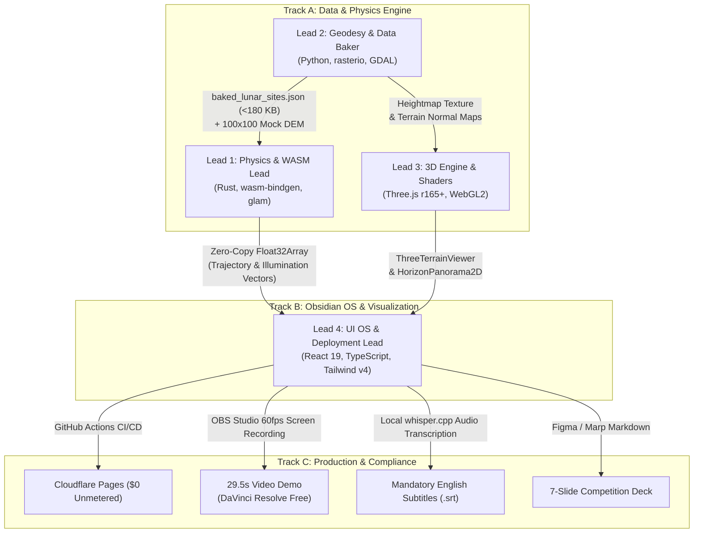

# FIRST CONTACT.SYS: 4-PERSON OPERATIONAL WORK BREAKDOWN & EXECUTION MATRIX
**Project Target:** 2026 NASA International Space Apps Challenge — Challenge 10: *CLPS: Lunar Landing Site Navigator*  
**Team Architecture:** 4 Core Leads (Coordinated Relay)  
**Budget Ceilings:** ₹0 Software & Hosting | ₹500 Emergency Physical Contingency Reserve  
**Target Global Awards:** Best Use of Science | Best Use of Technology | Art & Technology | Galactic Impact  

---

## 1. HIGH-LEVEL COLLABORATION TOPOLOGY



---

## 2. GRANULAR ROLE SPECIFICATIONS & DELIVERABLE OWNERSHIP

### Lead 1: Core Physics & WebAssembly Lead (The Math Engine)
* **Stack:** Rust 2021, `wasm-bindgen = "0.2.92"`, `wasm-pack`, `glam` (SIMD vector math).
* **Workspace & File Ownership:**
  - `wasm-science/Cargo.toml`
  - `wasm-science/src/lib.rs` (FFI interface and zero-copy memory exports)
  - `wasm-science/src/ephemeris.rs` (MOON_ME frame topocentric vector math)
  - `wasm-science/src/horizon.rs` ($O(1)$ dynamic mast clearance & penumbra fraction)
  - `wasm-science/src/survival.rs` (Battery SoC and LRO Diviner cryogenic equilibrium)
  - `wasm-science/src/solver.rs` (30-day sliding-window launch viability solver)
* **Exact Deliverables:**
  1. **Topocentric Ephemeris:** Vectorized trigonometry calculating hourly Sun and Earth azimuth and elevation in the `MOON_ME` (DE421) frame.
  2. **$O(1)$ Dynamic Mast Formula:**
     $$H_{\text{terrain}}(\theta, z_{\text{mast}}) \approx \arctan\left(\tan(H_0(\theta)) - \frac{z_{\text{mast}}}{d_{\text{crit}}(\theta)}\right)$$
  3. **Continuous Solar Penumbra Fraction:**
     $$f_{\text{sun}}(t) = \text{clip}\left(\frac{h_{\text{sun}}(t) + r_\odot - H_{\text{terrain}}(\lfloor\text{az}_{\text{sun}}(t)\rfloor, z_{\text{mast}})}{2 r_\odot}, 0.0, 1.0\right)$$
  4. **CLPS Battery State-of-Charge (SoC) Engine:** Numerical integrator modeling solar generation versus hotel and communication loads for Nova-C ($120\text{ W}$), Griffin ($280\text{ W}$), Blue Ghost ($160\text{ W}$), and Vikram ($100\text{ W}$).
  5. **Zero-Copy Memory Exports:** Expose direct pointers (`get_results_ptr()`, `get_results_len()`) into WebAssembly linear memory so Lead 4 can consume `Float32Array` views without JSON overhead.
  6. **WASM Size Optimization:** Implement `opt-level = "z"`, `lto = true`, and `wasm-opt -Oz` in `Cargo.toml` to produce a binary $<140\text{ KB}$ ($<40\text{ KB}$ gzipped).

---

### Lead 2: Geodesy Data Pipeline & Validation Lead (The Data Baker)
* **Stack:** Python 3.11+, `rasterio`, `skyfield`, `numpy`, `pytest`.
* **Workspace & File Ownership:**
  - `backend/tools/bake_lunar_data.py` (GeoTIFF parser and raymarcher)
  - `backend/tools/generate_mock_dem.py` (Zero-dependency synthetic test generator)
  - `backend/tests/test_science.py` (Validation suite vs. NASA SVS ground truth)
  - `frontend/public/data/baked_lunar_sites.json` (Static master dataset, $<180\text{ KB}$)
  - `docs/methodology.md` & `REFERENCES.md` (Scientific citations)
* **Exact Deliverables:**
  1. **Zero-RAM Crop Tooling:** Build memory-safe ingestion using `rasterio.windows.Window` ($<64\text{ MB}$ RAM footprint) to crop $100 \times 100$ pixel patches ($500\text{ m} \times 500\text{ m}$) from NASA GSFC PGDA Product 78 and Zenodo Record 17954508.
  2. **Horizon Profiler:** Implement a $360^\circ$ radial raymarcher stepping out to $30\text{ km}$ with spherical curvature correction ($R_{\text{moon}} = 1,737.4\text{ km}$) to output $H_0(\theta)$ and critical obstacle distance $d_{\text{crit}}(\theta)$.
  3. **5×5 Dispersion Safety Grid:** Compute slopes and geodetic RMS height uncertainties across $-200\text{ m}$ to $+200\text{ m}$ spatial offsets to empower the IM-2 Mons Mouton disaster preset.
  4. **Synthetic Mock Fallback Script (`generate_mock_dem.py`):** Author an immediate procedural generator (due within **Hour 1** of kickoff) that produces synthetic JSON and PNG heightmaps, allowing Leads 1, 3, and 4 to begin coding immediately without waiting for large NASA downloads.
  5. **Scientific Benchmarking:** Validate computed solar azimuth and elevation against NASA SVS 5587 hourly tables (`mooninfo_2026.json`), ensuring errors stay $<0.05^\circ$.

---

### Lead 3: 3D Visuals & Shading Engine Lead (The Graphics Engineer)
* **Stack:** Vanilla Three.js (r165+), WebGL2, Canvas API, GLSL shaders.
* **Workspace & File Ownership:**
  - `frontend/src/components/ThreeTerrainViewer.tsx` (3D displaced mesh and shadow caster)
  - `frontend/src/components/HorizonPanorama2D.tsx` (2D 360° skyline & libration loop)
  - `frontend/src/shaders/terrainShaders.ts` (Custom depth and slope color ramps)
* **Exact Deliverables:**
  1. **Terrain Displacement Mesh:** Displace a `THREE.PlaneGeometry(500, 500, 100, 100)` using the 16-bit LOLA heightmap texture.
  2. **The 1.5° Grazing Solar Shadow Engine:**
     - Attach a synchronized `customDepthMaterial` (`MeshDepthMaterial`) with matching displacement parameters to force the shadow pass to account for crater rims.
     - Eliminate shadow acne and self-occlusion at grazing angles by calibrating `shadow.normalBias = 0.04` and `shadow.bias = -0.00015`.
     - Configure `THREE.PCFSoftShadowMap` and constrain the orthographic shadow camera bounds tightly to $d = 320\text{ m}$.
  3. **Spacecraft Model & Dynamic Mast:** Render the modular lander model at the center of the site, scaling the mast visually from $0.5\text{ m}$ to $10.0\text{ m}$ in real time.
  4. **Interactive 5×5 Dispersion Visualizer:** Overlay the 25 clickable offset markers on the 3D surface; clicking any cell triggers a smooth camera tween and lander relocation.
  5. **Horizon Panorama 2D:** Render the $360^\circ$ obstacle skyline, solar grazing arc, 27.3-day Earth libration loop, and the Educator Mode $+0.57^\circ$ atmospheric refraction comparison band.
  6. **Low-Spec Device Lock:** Clamp Device Pixel Ratio (`Math.min(window.devicePixelRatio, 1.5)`) and disable unnecessary buffers (`alpha: false`, `stencil: false`) to ensure a rock-solid 60 FPS on integrated Intel UHD/Iris graphics.

---

### Lead 4: Tactical UI OS, Integration & Submission Lead (The Captain)
* **Stack:** React 19, TypeScript, Tailwind CSS v4, Cloudflare Pages, OBS Studio, `whisper.cpp`, DaVinci Resolve Free / CapCut.
* **Workspace & File Ownership:**
  - `frontend/src/App.tsx` (Root orchestration and persona state machine)
  - `frontend/src/components/HeaderAdamBridge.tsx` (Creation of Adam telemetry wireframe)
  - `frontend/src/components/HardwareProfileSelector.tsx` (Spacecraft hardware cards)
  - `frontend/src/components/DispersionGrid500m.tsx` (5×5 hazard scorecard)
  - `frontend/src/components/LaunchSlipMatrix.tsx` (30-day viability heatmap)
  - `frontend/src/services/missionEngine.ts` (WASM integration service)
  - `.github/workflows/deploy.yml` (CI/CD pipeline)
  - Presentation assets: 30-second MP4 video, subtitle file, 7-slide deck.
* **Exact Deliverables:**
  1. **Obsidian Tactical Aerospace OS:** Enforce color tokens (`#050608` deep obsidian, `#E2E8F0` regolith text, `#38BDF8` RF cyan, `#FACC15` solar gold, `#F43F5E` hazard crimson).
  2. **Header Adam Bridge:** SVG wireframe *Creation of Adam* bridge with a dynamic laser spark (Coherent Cyan pulse $\to$ Amber fading link $\to$ Crimson fractured shards).
  3. **Engine Integration:** Asynchronously initialize the Rust WASM module in Vite using `vite-plugin-wasm` and wire time scrubber events to the zero-copy TypedArray pipeline.
  4. **Zero-Cost Deployment:** Connect repository to **Cloudflare Pages** backed by GitHub Actions for automated, unmetered hosting with zero billing risk.
  5. **NASA-Compliant 30-Second Video Demo:**
     - Record 1080p 60 FPS gameplay using OBS Studio.
     - Generate synchronized `.srt` subtitles locally in seconds using `whisper.cpp` (`base.en` model).
     - Edit in DaVinci Resolve or CapCut; **cut strictly at 29.50 seconds** (885 frames at 30 fps) with burned-in subtitles.
  6. **7-Slide Competition Pitch Deck:** Author slides in Figma or Marp covering the IM-2 Athena failure, polar physics hazards, and First Contact.sys technical differentiators.

---

## 3. INTER-TEAM INTERFACE CONTRACTS

### Contract 1: Lead 2 $\to$ Leads 1, 3, 4 (`baked_lunar_sites.json`)
```json
{
  "site_id": "PGDA-20",
  "name": "Mons Mouton (IM-2 Athena)",
  "center_coords": { "lat": -84.7906, "lon": 29.1957, "elevation_m": 5420.4 },
  "horizon_mask_360": {
    "h0_deg": [1.2, 1.4, 1.8],
    "d_crit_m": [3200.0, 3150.0, 3400.0]
  },
  "dispersion_grid_5x5": [
    {
      "dx_m": 0, "dy_m": 0,
      "elevation_m": 5420.4, "slope_deg": 3.8,
      "status": "SAFE"
    },
    {
      "dx_m": -200, "dy_m": 200,
      "elevation_m": 5380.0, "slope_deg": 14.2,
      "status": "MISSION_LOSS_TRAP"
    }
  ]
}
```

### Contract 2: Lead 1 (Rust WASM) $\to$ Lead 4 (React UI)
```rust
// wasm-science/src/lib.rs
#[wasm_bindgen]
pub struct MissionEngine { /* ... */ }

#[wasm_bindgen]
impl MissionEngine {
    pub fn evaluate(&mut self, site_idx: usize, mast_m: f32, hotel_w: f32) { /* ... */ }
    pub fn get_results_ptr(&self) -> *const f32 { self.buffer.as_ptr() }
    pub fn get_results_len(&self) -> usize { self.buffer.len() }
}
```
```typescript
// frontend/src/services/missionEngine.ts
export function runSimulation(siteIdx: number, mastHeight: number, hotelLoad: number): Float32Array {
  engine.evaluate(siteIdx, mastHeight, hotelLoad);
  const ptr = engine.get_results_ptr();
  const len = engine.get_results_len();
  return new Float32Array(wasmModule.memory.buffer, ptr, len);
}
```

---

## 4. 39-HOUR HACKATHON RELAY TIMELINE

```
 SATURDAY (NOV 14)                                             SUNDAY (NOV 15)
 09:00 IST      14:00 IST             23:30 IST        09:00 IST        16:00 IST   21:30 IST
 ┌──────────────┬─────────────────────┬────────────────┬────────────────┬───────────┬───────┐
 │ SHIFT 1      │ SHIFT 2 (ALL)       │ SHIFT 3        │ SHIFT 4 (ALL)  │ SHIFT 5   │ SUBMIT│
 │ Setup & Mock │ 9.5h Heavy Overlap  │ Polish & Night │ Final Assembly │ Media Cut │ BUFFER│
 │ Repo Init    │ Three.js Shadows    │ Libration Math │ Edge Deploy    │ Subtitles │ 2.5h  │
 │ Rust Crate   │ Adam Telemetry Bar  │ Pytest Suite   │ Feature Freeze │ 7 Slides  │ Safe  │
 └──────────────┴─────────────────────┴────────────────┴────────────────┴───────────┴───────┘
```

| Shift | Hours | Lead 1 (WASM) | Lead 2 (Data Baker) | Lead 3 (3D Engine) | Lead 4 (UI & Submission) |
| :--- | :--- | :--- | :--- | :--- | :--- |
| **Shift 1** | Sat 09:00 – 14:00 | Initialize Rust crate; write DE421 trig math | **Deliver `generate_mock_dem.py` in Hour 1**; begin PGDA crop | Initialize Three.js scene; load mock heightmap | Initialize React 19 repo; deploy live scaffold on Cloudflare Pages |
| **Shift 2** | Sat 14:00 – 23:30 | Implement $O(1)$ mast formula and battery SoC | Run raymarcher; deliver final `baked_lunar_sites.json` | Calibrate grazing shadows & `customDepthMaterial` | Build Header Adam Bridge and hardware selector cards |
| **Shift 3** | Sun 00:00 – 09:00 | Code 30-day launch solver; export zero-copy pointers | Benchmark ephemeris vs NASA SVS 5587; write `methodology.md` | Build 2D Horizon Panorama & 27.3d Earth libration loop | Integrate WASM engine with 5x5 grid & launch slip matrix |
| **Shift 4** | Sun 09:00 – 16:00 | Unit tests & edge verification | Finalize `REFERENCES.md` and dataset provenance | Optimize 60 FPS performance; verify mobile DPR | **Full system assembly; test IM-2 failure preset; FEATURE FREEZE AT 16:00** |
| **Shift 5** | Sun 16:00 – 21:30 | Verify open-source MIT license & clean repo | Check scientific figures in slide deck | Assist screen captures in OBS | Transcribe via `whisper.cpp`; cut video at 29.5s; upload to YouTube; submit! |

---

## 5. ZERO-DOLLAR BUDGET ALLOCATION & TOOL MATRIX

```
                     ₹500 INR TEAM CONTINGENCY ALLOCATION
                                      │
         ┌────────────────────────────┴────────────────────────────┐
         ▼                                                         ▼
   ₹250 INR: Emergency Mobile Hotspot                        ₹250 INR: High-Caffeine Fuel
   (Jio/Airtel 50GB Data Booster)                            (Cold Brew / Tea / Energy Snacks)
   Protects against Wi-Fi failure during submission.         Sustains team focus across Shift 3 & 4.
```

* **Frontend & CDN Hosting:** ₹0 (Cloudflare Pages — unmetered bandwidth, zero overage risk).
* **Code & CI/CD:** ₹0 (GitHub Public Repository + Unlimited GitHub Actions).
* **NASA Planetary Data:** ₹0 (NASA GSFC PGDA Products 78 & 104, JPL Horizons REST API).
* **Video Production:** ₹0 (OBS Studio lossless recording + DaVinci Resolve Free / CapCut Desktop).
* **Subtitles & Transcriptions:** ₹0 (Local `whisper.cpp` CLI generating synchronized `.srt`).
* **Design & Pitch Deck:** ₹0 (Figma Free Starter Tier / Marp Markdown).

---

## 6. NASA SPACE APPS ANTI-DISQUALIFICATION CHECKLIST

1. [x] **Zero Pre-Built Code Rule:** The public GitHub repository must be completely empty prior to Saturday 09:00 AM local time. All commit timestamps must fall strictly within the official hackathon window.
2. [x] **Strict 30-Second Video Rule:** The demo video must be cut to **exactly 29.50 seconds** (885 frames at 30 fps). Never allow the video to reach 30.01 seconds.
3. [x] **Mandatory English Subtitles:** Spoken audio must have synchronized English captions burned directly into the video or uploaded as a `.srt` track.
4. [x] **Youth Privacy (Under-18 Rule):** Do not show the faces, names, or identifiable voices of any minor teammates. The video demo must consist purely of screen captures, kinetic typography, and adult voiceover.
5. [x] **Public Hosting Accessibility:** The YouTube video must be set to **Unlisted** or **Public**. Verify that the URL opens in an Incognito browser without requiring a Google login.
6. [x] **Open-Source Licensing:** Ensure the root repository contains a valid `LICENSE` file (MIT License) and a comprehensive `REFERENCES.md` crediting all NASA data products.
